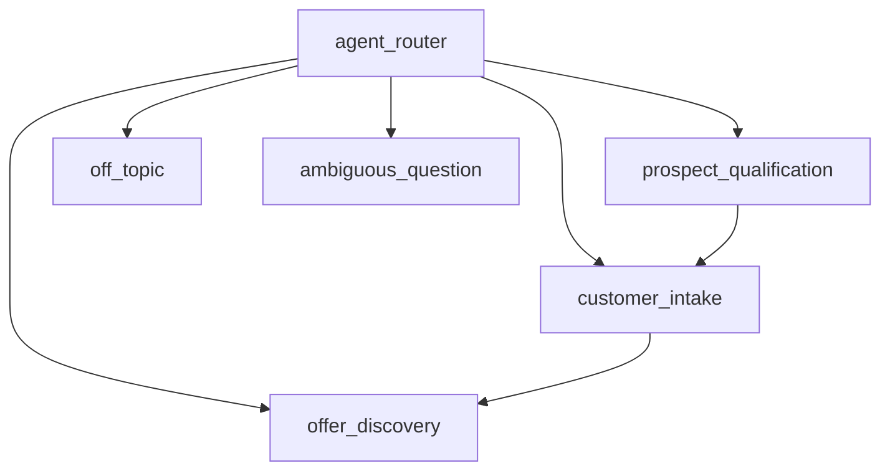

# Agent Spec: Offer Concierge (Banking demo — draft)

**Status:** Draft — aligned with catalog-only, description-driven qualification.

## Purpose & Scope

Customer-facing WhatsApp-style chat for a **banking** demo. The agent:

1. Loads the **active offer catalog** (exactly **two** credit-card products in demo data).
2. Asks **short qualification questions** inferred from each offer’s **`Description__c`** (who it is for, spending pattern, business vs personal, credit history, etc.) — **no** hard-coded question scripts in Apex.
3. Picks **one recommended offer** (exact catalog **Name**) from the conversation.
4. Collects identity details and saves a **Lead** after explicit confirmation.
5. Presents the **recommendation** and both catalog offers; customer may **confirm or switch**; persist choice on Lead when fields exist.

**Out of scope for now:** Personalized `Offer__c` rows per Contact/Lead (`Contact__c` / `Lead__c` lookups unused). Swag quiz. Hard-coded “Plan A / Plan B” in Agent Script.

## Offer catalog (data, not code)

- **Two** active `Offer__c` rows: e.g. **Newcomer Credit Card**, **Business Credit Card**.
- **`Active__c = true`**, valid **`ExpirationDate__c`** (or null). Seed script deactivates or removes all other rows.
- **`Description__c`** (long text) is the **source of truth for qualification**: eligibility, positioning, signal phrases (“first card”, “LLC”, “business expenses”). The LLM reads descriptions from **Get Offers** output and decides **what to ask** and **which name to recommend**.
- Optional presentation fields: **`Category__c`**, **`Price__c`**, **`Reason__c`** — chat display only; do not invent rates beyond stored data.

## Behavioral intent

- Warm, concise WhatsApp-style tone; no “type this command” language.
- **Only** discuss products returned by Get Offers (max two active).
- Recommend **exactly one** catalog name when qualification is complete; allow change after intake.
- Do not invent benefits or numbers not in action output.

## Configuration

- Agent type: `AgentforceServiceAgent`
- Default agent user: org-specific (`org-config/*/OfferConcierge.agent`)
- Permission set: `Offer_Demo_Access`

## Lead fields (org)

| Concept | Field | Values |
|--------|-------|--------|
| User’s final choice | **`Selected_Option__c`** (org field) | Exact catalog **`Name`** via `SaveLeadSelectedOption` |
| Recommendation (session only) | `recommended_offer_name` variable | Not stored on Lead (no Recommended field) |
| Qualification context | Lead **`Description`** on intake | Recommended card + optional notes via `SaveLeadProfile` |

Conversation transcript on Lead: later phase.

## Variables (session)

| Name | Purpose |
|------|---------|
| `offers_summary`, `offer_count` | From Get Offers (catalog) |
| `recommended_offer_name` | Exact catalog Name after qualification |
| `qualification_complete` | 1 when fit is clear enough to recommend |
| `Contact_Id`, `Lead_Id`, `intake_complete`, `prospect_email` | Identity / intake (unchanged) |
| `financial_goal_label` | Reuse for save: set to **recommended offer name** or short fit label |

## Subagent map

**Routing:**

- Anonymous, `qualification_complete = 0` → **prospect_qualification** (load catalog, ask description-driven questions, set `recommended_offer_name`).
- Anonymous, qualification done, intake not done → **customer_intake**.
- Identified (`intake_complete = 1` or Contact/Lead id) → **offer_discovery** (recommendation + both offers).

Remove / avoid: `more_offers` (only two products), per-customer Offer lookups, telecom goal/timeline steps.

## Actions

| Action | Backing | Purpose |
|--------|---------|---------|
| `get_offers` | `apex://GetOffersForCustomer` | **Active catalog only** (works with or without Lead/Contact) |
| `save_lead_profile` | `apex://SaveLeadProfile` | After confirm (Description notes) |
| `save_lead_selected_option` | `apex://SaveLeadSelectedOption` | When customer confirms or changes card |

Future (optional): Lead transcript, prompt-based analyze.

## Gating

- **Get Offers** may run **before** intake (qualification subagent).
- **Offer presentation / commitment** after intake (or when Contact id present from broker).

## Demo data

- `scripts/apex/seed_banking_offers.apex` — two rows, rich **`Description__c`** for question generation.

## Approval checklist

- [x] Catalog-only (no personalized Offer rows)
- [ ] Description-driven qualification copy in seed approved
- [ ] Lead field API names for selected/recommended
- [ ] Deploy agent + re-seed PC
