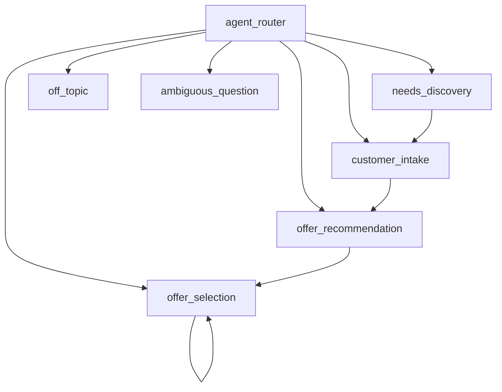

# Agent Spec: Offer Concierge (Banking demo — draft)

**Status:** Draft — awaiting approval before Agent Script / Apex / prompt implementation.

## Purpose & Scope

Customer-facing WhatsApp-style chat for a **banking** demo. The agent:

1. Learns what the visitor needs (short qualification / needs chat).
2. Collects identity details and saves a **Lead** after explicit confirmation.
3. Uses a **Prompt Template** plus live **Offer__c** data to **recommend** one of the active catalog offers from the conversation transcript.
4. Presents both offers, lets the customer **choose or change** their choice, and persists **recommended** vs **selected** on the Lead.
5. Stores the **full conversation** on the Lead for audit and prompt context on re-runs.

No swag quiz. No hard-coded “Plan A / Plan B” labels in Agent Script — **only `Offer__c` records** (name, pricing fields, and **`Description__c` long text**) define what can be suggested and how the prompt reasons about fit.

## Offer catalog (data, not code)

- Maintain **two (or more) active** `Offer__c` rows for the demo, e.g. newcomer consumer card and business card.
- **`Active__c = true`**, valid **`ExpirationDate__c`** (or null).
- **`Description__c`** (Long Text Area, up to 1000 chars) is the **primary prompt fuel**: eligibility, positioning, who it is for, benefits — written so the template can match conversation signals to an offer **without** inventing product rules in the agent.
- Optional: **`Category__c`**, **`Reason__c`**, price/discount for chat presentation after selection.
- **Catalog vs targeted:** For anonymous → Lead flow, offers may exist as **catalog** rows (no `Contact__c` / `Lead__c`) queried by a dedicated invocable, **or** be **linked to the Lead** after intake so existing `GetOffersForCustomer` applies. Spec assumes a single invocable **`get_offer_catalog`** (name TBD) returns all active catalog offers for the prompt; linking to Lead happens when saving selection (implementation detail).

## Behavioral intent

- Warm, concise WhatsApp-style tone; no scripted “type this command” language.
- After intake, call **analyze conversation** (prompt) once per “recommendation episode”; re-run when the customer materially changes needs or asks to reconsider.
- Present **exact** offer names and numeric fields from Salesforce; do not invent rates or benefits not in `Offer__c` / action output.
- Customer may switch offers anytime after intake; update **selected** on Lead and keep **recommended** from the last analysis.

## Configuration

- Agent type: `AgentforceServiceAgent`
- Default agent user: org-specific (see `org-config/*/OfferConcierge.agent`)
- Permission set: `Offer_Demo_Access` (read/write `Offer__c`, Lead, prompt invocation)

## Lead fields (org)

| Concept | Field (confirm API name in Partner Central) | Values |
|--------|-----------------------------------------------|--------|
| User’s final choice | `Selected_Option__c` (label: Selected Option) | **Offer `Name`** (or Id — pick one convention and stick to it) |
| Prompt suggestion | Recommended Option (add if missing) | Same convention as selected |
| Full chat | Conversation transcript (add if missing) | Append-only text |

## Variables (session)

| Name | Purpose |
|------|---------|
| `Contact_Id`, `Lead_Id`, `intake_complete`, `prospect_email` | Identity / intake gating (existing pattern) |
| `needs_complete` | Qualification done → intake |
| `qualification_*` / needs slots | Until banking copy replaces telecom qualification |
| `conversation_transcript` | Running transcript (optional if Apex-only on Lead) |
| `recommended_offer_id` / `recommended_offer_name` | From analyze action |
| `selected_offer_id` / `selected_offer_name` | User choice; drives Lead update |
| `offer_catalog_summary` | Serialized catalog for agent display (from Apex) |

Use `@utils.setVariables` for LLM-filled slots; deterministic `set` after invocables.

## Subagent map

**Routing (summary):**

- Anonymous, `needs_complete = 0` → **needs_discovery**
- Anonymous, needs done, intake not done → **customer_intake**
- Identified Lead/Contact, no recommendation yet → **offer_recommendation**
- After recommendation, or user talking about picking/changing → **offer_selection**
- Identified + general offer questions → **offer_selection** or lightweight Q&A grounded on catalog action output

Remove: `swag_quiz`, `more_offers` (optional merge into recommendation/selection).

## Actions & backing logic

| Action | Backing | Purpose |
|--------|---------|---------|
| `save_lead_profile` | `apex://SaveLeadProfile` | EXISTS — intake after confirm |
| `get_offer_catalog` | Apex **NEW** | Query active catalog `Offer__c` (Id, Name, Description__c, price fields); build JSON/text for prompt + agent |
| `analyze_conversation_for_offer` | Prompt template **NEW** (+ optional Apex wrapper) | Inputs: transcript + catalog payload; outputs: recommended offer id/name, short rationale (JSON preferred) |
| `append_conversation` | Apex **NEW** | Append user/agent turn to Lead transcript field |
| `update_lead_offer_choice` | Apex **NEW** | Set Selected (+ optionally Recommended) on Lead; optionally link `Offer__c.Lead__c` |

### Prompt template design

- **Inputs:** `conversationTranscript` (string), `offersCatalog` (string — JSON array of `{ "id", "name", "description" }` built from **`Description__c`** and other allowed fields).
- **Instructions:** Choose exactly one recommended offer from the catalog based only on catalog text and transcript; output structured JSON e.g. `{ "recommendedOfferId", "recommendedOfferName", "rationale" }`.
- **Not in prompt:** Hard-coded plan names; all product rules live in **`Offer__c.Description__c`**.

### Presentation after analysis

- Agent shows **both** catalog offers (short chat bullets using formatted fields from Apex).
- Clearly state which offer is **recommended** and why (from `rationale`, paraphrased briefly).
- **offer_selection** subagent handles “I’ll take the other one” → `update_lead_offer_choice`.

## Gating

- No offers / analyze until `intake_complete = 1` or `Contact_Id` set (same as today).
- Do not call analyze until catalog returns at least one active offer.

## Guardrails

- `off_topic`, `ambiguous_question` — unchanged role; redirect to banking offers / needs.

## Demo data

- Add seed script (or extend `scripts/apex/seed_offers.apex`) with **two banking** `Offer__c` catalog rows and rich **`Description__c`** text for newcomer vs business card.
- Deprecate telecom-oriented seed copy for Partner Central banking path when switching demo narrative.

## Out of scope (this phase)

- Swag quiz and quiz metadata.
- Dynamic offer count beyond catalog query (still N active offers, demo uses N=2).

## Approval checklist

- [ ] Subagent map and routing approved
- [ ] Lead field API names confirmed (`Selected_Option__c`, recommended, transcript)
- [ ] Offer catalog query rules (global active vs Lead-linked) approved
- [ ] Prompt output JSON shape approved
- [ ] Seed offer names and Description__c copy approved
